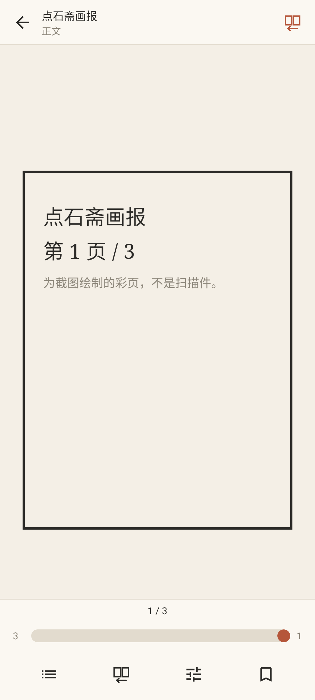
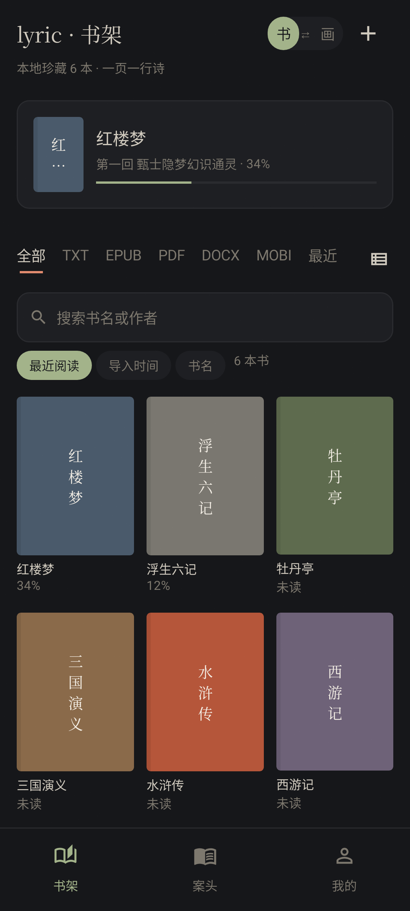

<p align="center">
  
</p>

# Lyric · 抒情诗

**一句话定位：** 安静的本地阅读器：打开即读，没有多余的东西。  
**One-liner:** A quiet, local Android reader: open a book and start reading, with nothing extra.

Lyric 是一个纯本地、无书源、无广告的 Android 阅读器。支持 TXT / EPUB / PDF / CBZ / DOCX / MOBI / AZW3，以及图片与 ZIP 漫画包。Kotlin + Jetpack Compose / Material 3，界面为简体中文。没有网络权限、账号、广告或在线书源。首次打开是空书架：一句「书架还空着」和一个「导入书籍」按钮，选一本即可开始读。

Lyric is a free, open-source, offline Android reader. It opens TXT, EPUB, PDF, CBZ, DOCX, MOBI, and AZW3 books (plus images or ZIP comic archives) and stays on the device. There are no accounts, ads, or online catalogs. The first launch is an empty shelf with one short prompt and an import button.

视觉与字体：依据 [design/v1.0/tokens.md](design/v1.0/tokens.md) 与 [design/design-spec.md](design/design-spec.md)。正文内置思源宋体 Noto Serif CJK SC（[SIL Open Font License 1.1](third_party/NotoSerif-OFL.txt)），界面使用系统黑体，也可自行导入 TTF/OTF。

## 下载 / Download

最低 Android 8.0（API 26），目标 API 35。1.0 性能验收机型为 **Find X9 Pro**。

正式签名包将随「正式发布包」发布到 [GitHub Releases](https://github.com/huangxinrui156/lyric/releases)，并附 SHA256。当前请从源码构建（见下方）；debug APK 路径为 `app/build/outputs/apk/debug/app-debug.apk`。

The signed release will be published on [GitHub Releases](https://github.com/huangxinrui156/lyric/releases) with a SHA256 checksum. Until then, build from source. Minimum Android 8.0 (API 26). The 1.0 performance baseline is measured on a Find X9 Pro.

## 截图 / Screenshots

美术设计选定的界面稿（JVM 渲染，1080×2400，密度 2.75）。生成方法见 [docs/screenshots.md](docs/screenshots.md)。

Design-selected shots (JVM-rendered, 1080×2400 at density 2.75). See [docs/screenshots.md](docs/screenshots.md).

<p align="center">
  
  
  
  
</p>

<p align="center">书架日间 · 阅读日间 · 漫画日间 · 书架夜间</p>

其余渲染稿在 `screens/`（不进 git）。重新生成：

```bash
bash tools/render-screens.sh
```

## 构建 / Build

需要 JDK 17、Android SDK 35 / Build Tools 35.0.0。仓库已包含 Gradle 8.9 wrapper。首次构建需联网下载依赖；**应用运行时不访问网络**。

You need JDK 17 and Android SDK 35 (Build Tools 35.0.0). The Gradle 8.9 wrapper is committed. The first build needs a network connection to fetch dependencies; **the app itself does not use the network**.

```bash
export JAVA_HOME=/home/box/jdk17
export ANDROID_HOME=/home/box/Android
# 其他机器：在 local.properties 中设置 sdk.dir，或设置 ANDROID_HOME
./gradlew assembleDebug test assembleBenchmark
bash tools/check-tokens.sh
bash tools/check-licenses.sh
adb install -r app/build/outputs/apk/debug/app-debug.apk
```

测试报告：`app/build/reports/tests/testDebugUnitTest/index.html`。Lint：`app/build/reports/lint-results-debug.html`。更完整的设备验证步骤见 [docs/validation.md](docs/validation.md)。发版、升版本、签名与打标签见 [RELEASING.md](RELEASING.md)。

Build reports: `app/build/reports/tests/testDebugUnitTest/index.html`. For versioning, release signing, and tags, see [RELEASING.md](RELEASING.md).

## 隐私 / Privacy

不采集、不上传任何数据。所有书籍、进度、摘录、阅读统计与设置仅存本机。没有账号、广告、分析 SDK 或遥测。应用未声明 `INTERNET` 网络权限，不访问网络；本地文件仅使用系统文件选择器授予的权限读取。仅在你主动导出时，将备份或摘录写到你选择的位置。卸载应用将删除私有数据。

Lyric does not collect or upload any data. All books, progress, highlights, reading stats, and settings stay on the device. There is no account, advertising, analytics SDK, or telemetry. The app does not declare the `INTERNET` permission and does not access the network. Local files are read only through permissions you grant with the system file picker. Backups or exported notes are written only when you choose a destination. Uninstalling the app removes its private data.

## 许可证 / License

Lyric 以 [Apache License 2.0](LICENSE) 发布。Copyright 2026 黄新瑞。第三方依赖的许可证见下方与应用内 [open-source-notices.txt](app/src/main/assets/open-source-notices.txt)。请运行 `bash tools/check-licenses.sh`，确认 `app/build.gradle.kts` 中的实现依赖均在已知许可证清单内。

Lyric is released under the [Apache License 2.0](LICENSE). Copyright 2026 黄新瑞. Third-party notices are listed below and in [open-source-notices.txt](app/src/main/assets/open-source-notices.txt). `bash tools/check-licenses.sh` fails if a new runtime dependency is added without a recorded license.

| 依赖 / Dependency | 许可证 / License |
|---|---|
| Kotlin, kotlinx.coroutines, kotlinx.serialization | Apache-2.0 |
| AndroidX（Compose、Material 3、Room、DataStore 等） | Apache-2.0 |
| Coil 2（含 coil-svg）、AndroidSVG 1.4 | Apache-2.0 |
| jsoup | MIT |
| juniversalchardet | MPL-1.1 |
| Noto Serif CJK SC | SIL Open Font License 1.1 |

变更记录见 [CHANGELOG.md](CHANGELOG.md)。发版流程见 [RELEASING.md](RELEASING.md)。问题与建议请用 [Issue 模板](.github/ISSUE_TEMPLATE)。

---

以下为开发与验收记录（含 0.9.7.1 加载与 1.0 性能底线）。

## 加载卡顿专项（0.9.7.1 / vc35）

应用版本 0.9.7.1（versionCode 35），对比未修改的 0.9.7 / HEAD 74b4882。实现、测量边界与剩余风险见 [加载调查](docs/v0.9.7-load-jank.md#0971-按需-epub-与性能记录)，原始逐轮数据见 [主机测量记录](docs/measurements/v0.9.7.1-load-host.txt)。图标、名称、阅读和书架动画、0.9.7 骨架视觉与 300/300/150ms 防闪策略保持。

EPUB 缓存未命中先发布 TOC/spine 与当前位置前后各一章；首窗 ready 后后台逐章解析并原子缓存。新导入建立分章缓存；旧 parsed-v1 全书 JSON 继续可读。目录、搜索、书签、划线和翻页进入未解析章时先读该章；全书长度稳定前隐藏百分比并暂不可拖全书进度，长度稳定后使用固定 prefix，当前位置不变。正常 TXT/CBZ/PDF 打开路径保留。

以下全部为 **主机测量，单位 ms，依次列两轮**。同一 0.9.7 harness：冷开删除解析缓存，磁盘暖开新 repository，同实例暖开复用 reader Book；为保证相同的完整暖缓存状态，0.9.7.1 在首窗计时结束后等待后台填充完成再测暖开。OS 页缓存未清。首窗为 12k 字排版窗/首张位图，**不含 Compose/GPU 首帧、骨架停留或淡入，不能代表 Find X9 Pro 帧时间**。

| 主机测量样本 / 状态 | 0.9.7 open | 0.9.7.1 open | 0.9.7 首窗/图 | 0.9.7.1 首窗/图 |
| --- | ---: | ---: | ---: | ---: |
| EPUB 1248 章 / 冷 | 1965 / 1655 | 300 / 260 | 2058 / 1657 | 387 / 262 |
| EPUB 1248 章 / 磁盘暖 | 431 / 218 | 23 / 15 | 434 / 220 | 25 / 18 |
| EPUB 1248 章 / 同实例暖 | 306 / 220 | 6 / 4 | 309 / 223 | 7 / 6 |
| TXT 10MiB / 冷 | 66 / 65 | 68 / 56 | 106 / 83 | 107 / 74 |
| TXT 10MiB / 磁盘暖 | 33 / 33 | 114 / 30 | 59 / 49 | 139 / 46 |
| TXT 10MiB / 同实例暖 | 3 / 2 | 2 / 2 | 23 / 15 | 22 / 15 |
| CBZ 500 页 / 冷 | 26 / 25 | 27 / 26 | 41 / 37 | 42 / 39 |
| CBZ 500 页 / 磁盘暖 | 23 / 6 | 19 / 6 | 40 / 20 | 32 / 19 |
| CBZ 500 页 / 同实例暖 | 3 / 2 | 2 / 2 | 17 / 16 | 16 / 15 |

| 主机测量导入 wall（含复制/哈希、解析、封面、缓存、Room） | 0.9.7 ms | 0.9.7.1 ms |
| --- | ---: | ---: |
| EPUB | 2676 / 1903 | 2924 / 1956 |
| TXT | 123 / 101 | 159 / 95 |
| CBZ | 846 / 570 | 632 / 593 |

单线程 UI 替身 10ms 探针最大队列等待：0.9.7 为 2ms、0.9.7.1 为 3ms（主机测量）；不能当作 Android Main 阻塞或流畅度验收。TXT 磁盘暖开首轮有明显波动，两轮不足以声称该格式性能提升。新分章缓存同实例暖开复用当前 Book，不再重复反序列化超大 JSON；只用弱引用登记，后台完成后不额外强持有整书。

Debug 保持非压缩构建；`benchmark` 保持 debug 签名、R8 minify/shrink、ProfileInstaller 和离线 profile seed，无新增依赖。运行 `./gradlew assembleDebug test assembleBenchmark`；测试计数见加载调查中的最终验证记录。性能日志默认关闭：我的 → 关于 → 连点版本行 7 次 → 开启「性能记录」，复现后回到同一入口点「导出性能记录」并在系统分享面板发送。详细无 adb 操作见 [设备清单](docs/v0.9.6-device-checklist.md#0971-性能记录的开启与导出无需-adb)。

**Find X9 Pro 全部待真机**：≤300ms 首屏/骨架、无 >100ms 加载帧、文字 ≤1.5s、漫画 ≤1s、翻页/滚动 P95 ≤16.7ms、Java+native+graphics 峰值 ≤256MB、后台解析/导入中书架滚动。日志内存为 250ms 采样的 Java/native 分配量峰值，不含 graphics；不能据此勾选总进程峰值通过。旧全书 JSON 首次读取、大资源 EPUB 的 ZIP 解包/Base64、长 PDF、GC、同步生命周期持久化仍需设备复验。

## 1.0 性能底线

> 用正式包在 Find X9 Pro 上测（新瑞 11/16 选 A：1.0 只测这一台，README 注明测试机型）：1248 章 EPUB 和 10MB TXT 首屏 1.5 秒内，500 页 CBZ 首页 1 秒内，滑动 P95 帧时间不超过 16.7ms，内存峰值低于 256MB；数据写进 README。

被测包为 **0.9.7.1 / vc35** 的 `benchmark` / R8 正式风格 APK，包名 `com.lyric.reader.benchmark`：release 衍生、debug 签名、不可调试、minify/shrink、ProfileInstaller；构建 `./gradlew :app:assembleBenchmark :macrobenchmark:assembleBenchmark`。签名 Play/GitHub 发布包是后续任务。**1.0 验收机型：Find X9 Pro。** 约 4GB 内存机（默认 Redmi A3）的补测是 P1，不挡 1.0。

| 项目 | 1.0 目标（Find X9 Pro） | 主机测量（历史，非设备验收） | Find X9 Pro |
| --- | --- | --- | --- |
| 1248章 EPUB 首屏 | 五轮 MAX <1500ms | 首窗 387 / 262ms | 待真机 / 未测 |
| 10MB TXT 首屏 | 五轮 MAX <1500ms | 首窗 107 / 74ms | 待真机 / 未测 |
| 500页 CBZ 首页 | 五轮 MAX <1000ms | 首图 42 / 39ms | 待真机 / 未测 |
| 滑动 P95 | ≤16.7ms（文字滚动、漫画滑动） | 未测，无设备帧时间替代值 | 待真机 / 未测 |
| 内存峰值 | <256MB，含 graphics | 未测，无总进程内存替代值 | 待真机 / 未测 |

**待测原因：本环境无 adb/真机测量条件，无模拟器及 Find X9 Pro。** 主机列沿用 [0.9.7.1 原始两轮数据](docs/measurements/v0.9.7.1-load-host.txt)，首窗/解码不含 Compose/GPU 首帧、骨架停留或淡入，不能判定真机达标。历史 0.3 的入门机 25ms / 3000ms 门限不用于 1.0。`TIER=reference` 为 1.0 必跑路径；`TIER=entry` 仍可用、限值相同，但是可选的 P1 低端机补测，结果如需记录请另行列出，不填进上表。

方法：每项 5 轮；prepare 导入、设置重置与解析/图片缓存清理在计时外，冷开用 `StartupMode.COLD` 重启进程。首屏取真实内容可见后的 `reportFullyDrawn` / `timeToFullDisplayMs`（同时记录 `Lyric.ColdOpen`），文字等待 `Lyric正文:`，漫画仅成功解码且加载层结束才出现 `Lyric漫画:`。文字主测 `PageMode.SCROLL`，每轮 30 次滑动，漫画另测 30 次 RTL pager 手势；合并五轮原始 `frameDurationCpuMs`，以 nearest-rank `ceil(N×0.95)` 算 P95。

内存：全部冷开/滑动 run 使用 `MemoryUsageMetric(Mode.Max)`，要求 HeapSize、RssAnon、RssFile、RssShmem、Gpu 都有五轮数据。每轮 RSS 三项峰值 + GPU 峰值之和，再取五轮最大值，按 KiB ×1024 / 1,000,000 转十进制 MB，严格 <256；这是**含 graphics 的进程驻留内存保守上界**，可能重复计数/不同步峰值，非精确 PSS。heap 不重复加；缺任何分项即失败。脚本另存 `dumpsys meminfo` 的 TOTAL PSS / HEAP / GRAPHICS 原文（设备有输出时），快照不冒充峰值；Java heap 或 PerfLog 250ms 采样不能单独验收。

夹具：TXT 设备生成恰好 10MiB UTF-8；EPUB SHA-256 `8368c9b1a06a5ce8ba156fda5892cb20020b008680dbc8a99de2d833cc789940`；CBZ SHA-256 `db3269a3b229bc6f75e351ab10e94175a8bbbea63383eba66f229e48f841a4c7`。脚本推送 `/data/local/tmp/lyric-fixtures/`（644）并尝试 Download 备用路径。固定默认排版、竖屏、系统动画 1×、关闭省电、刷新率建议 60Hz，记录 API/系统增量版本/物理 RAM/电量温度。

```bash
export JAVA_HOME=/home/box/jdk17 ANDROID_HOME=/home/box/Android
./gradlew assembleDebug test assembleBenchmark :macrobenchmark:assembleBenchmark
# 电脑需有 adb；连接 Find X9 Pro 并授权，ANDROID_SERIAL 填实际序列号：
export ANDROID_SERIAL='实际序列号'
# 源路径可用 LYRIC_EPUB_FIXTURE / LYRIC_CBZ_FIXTURE 覆盖。
# 1.0 必跑（Find X9 Pro）：
TIER=reference scripts/run-benchmarks.sh benchmark-results/find-x9-pro
# 可选 P1：借到约 4GB 手机后再跑，更新 ANDROID_SERIAL，使用新的空目录。不挡 1.0：
# TIER=entry scripts/run-benchmarks.sh benchmark-results/redmi-a3-4gb
python3 -m unittest scripts/test_benchmark_results.py
```

新瑞的完整步骤、Download 权限/fixturePath、无 adb 补充记录及回填格式见 [1.0 性能底线说明](docs/v1.0-perf-baseline.md)。脚本执行 `:app:assembleBenchmark :macrobenchmark:connectedBenchmarkAndroidTest`，结果写入指定空目录（默认 `benchmark-results/时间戳/`），保留 JSON、trace、设备条件、meminfo、报告和 `check.txt`；无 adb/设备或缺任一必需测量均失败。新瑞仍需在 Find X9 Pro 上完成 1.0 真机测量并回填数据和证据；约 4GB 补测为可选 P1。

## 操作

- 书架右上角或末格「＋」导入文件；「本地导入」也支持递归扫描文件夹。系统文件选择器可多选。
- 书架支持三列网格 / 列表、最近阅读 / 中文书名排序、TXT / EPUB / 最近筛选。长按封面移出书架，清除该书进度，保留阅读足迹、书签摘录和原文件。
- 阅读页轻点左右侧翻页、中央唤出菜单；也支持左右滑动、方向键、音量键。滚动模式上下滑动；在章节边缘继续滑动进入前后章。
- 菜单可拖动全书字符进度、跳章、打开左侧目录 / 书签、全文搜索。右上角夹入带摘录和时间的书签。
- 「排版」实时预览字号、主题、字体、翻页方式。「更多」设置行段距、边距、缩进、对齐、系统深色、遮光、深绿 / 纯黑 / 自定色和点击区域。选择修改范围「全局 / 文字书籍 / 本书」，「恢复继承」移除该层覆盖。
- TXT 的「更多」可切换编码并应用自定义章节正则，留空恢复默认。编码与章节规则始终只对本书生效。

- 「我的」查看今日 / 本周分钟数、累计读完本数和连续阅读天数；近 26 周热力图可点日期查看当天书籍。每日目标默认关闭，可开启细环进度，没有推送。
- 「书签与摘录」按书分组、时间倒序，搜索书名 / 章节 / 摘录，点击跳到原文；已移除或失效的书显示灰态。当前筛选结果可通过系统文件选择器导出 Markdown。
- 「外观」即时切换应用的跟随系统 / 浅 / 深主题、6 种克制强调色和默认阅读纸色。「阅读偏好」直接编辑全局层，支持排版、点击区、音量键、常亮与方向锁定，并显示单独设置的书籍数，可批量恢复继承。
- 「数据」导出 `lyric-backup-YYYY-MM-DD.zip`，含数据库 JSON、设置 JSON、可选导入字体。恢复先预览再确认；按 SHA-256 bookId 匹配本机来源，缺失项等待重新导入；保留更新的进度，重复恢复不会重复累计时长或书签。原书文件需另行保管。
- 「存储」分项查看解析 / 图片 / 临时缓存、导入字体、封面大小。清理后重新打开书籍会重建缓存；已登记的原文件和封面受保护。可修复或移除失效书籍。
- 「关于」显示实际构建版本、完整离线开源许可与本机隐私声明。仓库未提供维护者邮箱，界面如实说明。WebDAV（P2）尚未实现。

「我的」验收明细、备份格式和边界见 [docs/me-page-implementation.md](docs/me-page-implementation.md)。

## 0.3 阅读体验与真机基准

版本 `0.3.2`（versionCode `5`）。本次 EPUB 导入与整屏仿真翻页修复见 [docs/v0.3.2-changes.md](docs/v0.3.2-changes.md)。完整逐条证据与待实机项目见 [docs/v0.3-status.md](docs/v0.3-status.md)，需求见 [docs/v0.3-spec.md](docs/v0.3-spec.md)。

- 翻页立即排队保存进度，滚动只合并尚未开始的写入；会话每15秒更新同一行，暂停/停止补写并等待落盘。继续保留30秒空闲封顶和少于10秒会话过滤。
- 可见窗口、当前章及前后章先分页，其余后台计算；读取与重新分页时显示纸色骨架行。字体、边距、方向与模式变化保留原文锚点。
- 阅读信息栏可逐项关闭章节名、页码、百分比、时间、电量，均为正文70%字号，默认只显示章节名和百分比。
- 长按选词、拖动两端手柄扩选；拖到边缘稍候可继续翻页或滚动跨页。浮动菜单只有「复制 / 存为书签摘录 / 分享」。两个阅读模式共用全书字符选区。
- 音量键翻页默认关闭，可在阅读偏好或排版“更多”中开启并互换方向；仅阅读正文时生效，打开菜单、搜索、目录、选区工具条或大图后恢复系统音量。
- EPUB增加对齐、缩进、粗斜体、标题、居中、分隔线、图片、ruby注音和内嵌字体。书籍CSS与内嵌字体受「采用书籍样式」控制；图片、语义样式与注音始终显示。图片点击可放大并缩放/平移。完整CSS不在范围内。

### 目标与当前结果

以下为 0.3 历史目标与结果（含当时的两机与入门机宽松限值）。1.0 验收只要求 Find X9 Pro，门限见上文「1.0 性能底线」；约 4GB 补测是 P1。脚本的 `TIER=entry` 仍保留且与 1.0 使用相同数值门限，但不再使用本表的 25ms / 3000ms。

每版在CI外手动跑两台真机，记录系统版本、内存配置、刷新率、电源/温度条件和原始Perfetto/JSON。固定默认18sp、平移翻页；测试期间关闭省电模式、保持相同刷新率，避免充电发热或后台负载改变比较条件。

| 机型 | 定位 | 翻页 frameDurationCpuMs P95 | 10MiB TXT冷打开（正文首帧） | 搜索首条绘制 | 0.3实测 |
|---|---|---|---|---|---|
| OPPO Find X9 Pro | 基准机 | ≤16.7ms | <1500ms | <1000ms | 未测：本环境没有连接设备 |
| Redmi A3 **4GB** | 固定下限机 | ≤25ms | <3000ms | <1000ms | 未测：本环境没有连接设备 |

帧时间用FrameTimingMetric的原始帧分布算P95；冷打开和搜索各5轮，报告并校验最大值。冷打开清除解析与图片缓存，重启进程，使用恰好10MiB UTF-8 TXT（10,485,760字节）；终点为正文首帧的reportFullyDrawn，包含启动/读取/解析/首屏排版，不把骨架帧当作正文。搜索唯一关键词在6MiB处，trace包含输入处理、防抖、扫描与首条结果绘制。页面帧测5轮，每轮30次正常动画翻页。AndroidX指标定义见 [Macrobenchmark metrics](https://developer.android.com/topic/performance/benchmarking/macrobenchmark-metrics)。

```bash
export JAVA_HOME=/home/box/jdk17 ANDROID_HOME=/home/box/Android
# 无设备也可编译应用、宏基准测试APK与debug集成测试APK：
./gradlew assembleDebug test :app:assembleBenchmark :macrobenchmark:assembleBenchmark :app:assembleDebugAndroidTest

# 接上OPPO Find X9 Pro；多设备时先设 ANDROID_SERIAL：
TIER=reference scripts/run-benchmarks.sh
# 接上Redmi A3 4GB：
TIER=entry scripts/run-benchmarks.sh

# debug APK，am kill与前台force-stop各20次（约15分钟，视设备而定）：
scripts/kill-test.sh
```

宏基准使用独立包 `com.lyric.reader.benchmark`（release衍生、不可调试、shell profileable），不访问正式包的数据。准备10MiB夹具、导入及清缓存在计时外，打开/翻页/搜索走实际ReaderScreen。Macrobenchmark需要API29+真机；不会默认压制设备配置错误。脚本输出到 `benchmark-results/时间戳/`，保存设备属性、测试报告、原始JSON和Perfetto trace，并自动判定门限；运行后将两台实测数值和报告路径回填本表。

kill脚本安装debug包，不清库，添加明确命名的本地夹具，仅给夹具书设置音量键翻页。debug专用Provider读取实时Locator、会话秒数与Room快照；每轮真实翻页、等待进行中checkpoint，然后杀进程。am kill先按Home（该命令只杀后台进程），force-stop在前台执行；确认进程退出后比对落盘与重开锚点，要求完全一致且时长损失0–15秒。结果逐轮写JSON；任一失败返回非零。探针不会进入release或benchmark APK。

没有实机数据的门限、触控选区及20本真实EPUB阅读巡检均不标为通过。20个生成EPUB解析样例与JVM渲染测试只能提供自动化回归证据。

## 架构

```text
SAF URI / 文件 ContentSource
  → ParserRegistry（扩展名 → TxtParser / EpubParser）
  → Book + Chapter → ContentUnit.TextSpan | ContentUnit.ImagePage
  → ReaderSession → EngineRegistry（contentType → ReaderEngine）
  → TextReaderEngine + 后台 StaticLayout / ReaderCanvas
  → Progress / Bookmark（bookId + chapterIndex + Locator）
```

- `core/`：与 Android 无关的模型、编码、解析器。TXT 保留规范化后的全部字符；只将 CRLF/CR 转为 LF、去除 BOM，不插入排版字符。默认检测「第…章 / 卷 / 回 / 节 / 部 / 篇」与 Chapter（含罗马数字）；无标题按 10,000 UTF-16 字符切段，并保护代理对。自定义规则按整行匹配，仅检查短行。
- EPUB：zip + Jsoup，遵循 OPF spine 顺序；优先 EPUB 3 Nav，回退 EPUB 2 NCX，支持锚点字符定位；去除脚本和样式节点，不执行活动内容。限制归档条目数和解压大小，拒绝越界路径。正文和样式/图片/ruby范围分开存储；仅解析文档内与本地链接的CSS子集，不执行活动内容或加载远程资源。内嵌字体与图片离线读取。
- `reader/`：`ReaderEngine.open/goTo/currentLocator/settings`；`ReaderSession` 根据内容类型创建引擎。`Typesetter` 在 Default dispatcher 排版，使用 StaticLayout 的真实行边界分页，单次最多排版 12,000 字符，超长章节按窗口继续。覆盖和平移仅在翻页反馈时运行 280ms 动画；无动画直接切换；滚动使用惯性滚动。排版 spans 与缓存窗口均不改变原文偏移。
- `data/`：Room v3 存书架、进度（外键级联）、书签、独立的阅读会话与读完记录；移出书架不会清除足迹与摘录。v1 → v2 → v3 使用真实 Migration，v3增加书籍/进度/书签内容修订号，以一次性重映射旧EPUB锚点；原摘录、ID和时间保留。导出 schema 位于 `app/schemas/`。SHA-256 流式哈希去重，重导入同一文件会修复来源 URI，不丢失进度。SAF 只申请并持久化读取权限；不申请广泛存储权限。原始文件不复制到书架目录、不写入或删除。解析后原子写入私有 JSON 缓存，内存仅保留最近两本。每次打开和回到书架都检查原文件访问能力，失效时标记并显示错误。
- DataStore：仅存发生变化的设置字段，按默认值 → 全局 → 内容类型 → 本书合并。书架视图与排序也持久化。编码 / 章节规则记在 Room 的书籍记录中。
- `ui/`：单 Activity + Navigation Compose、ViewModel + StateFlow、生命周期感知收集、手动 DI。导入在 Application scope 的 IO dispatcher 执行，离开书架不会中断；每本书分别反馈成功 / 重复 / 失败。全文搜索是可取消的后台 Flow，首条结果立即发出，再分批更新 UI，最多显示 2,000 条。

定位不依赖页码：文字为 `chapterIndex + charOffset`（章节规范文本中的 UTF-16 offset），漫画为 `chapterIndex + page`。调整字体、页边距、翻页方式不修改定位。进度按字符数计算；漫画按图片页数计算，已有序列化与定位测试。V2 新增漫画 ContentSource / Parser 和 ImageReaderEngine / 视图即可，书架、Room 进度和书签表无需变更。书签摘录通过内容类型统一生成。当前未提供漫画导入或渲染引擎。

进度在翻页后立即提交到应用级串行 IO writer，不再防抖；滚动只合并未开始的写入。退出、Activity 暂停 / 停止会等待最终进度与会话写入完成。字体变化保留原文锚点，显示包含该锚点的新页。重设编码 / 章节规则时按全书绝对字符位置重映射进度与书签（编码更正若改变字符数，只能尽力接近原位置）。

## 验收状态

| # | 结果 | 已实现与限制 |
|---|---|---|
| 1 书架 | 功能完成，性能待实机量测 | 继续阅读、Lazy 网格 / 列表、最近 / 书名排序、长按移出。500 本仅按可见项组合；尚未给出 500 本真机帧时间报告。 |
| 2 导入 | 功能完成 | SAF 多文件与递归文件夹、持久读取授权、SHA-256 去重、逐本进度、失效来源处理。导入不使用前台服务；进程被杀后需重新选择未完成的批次，已导入项保留。 |
| 3 编码 | 完成 | UTF-8/BOM、UTF-16 LE/BE、GBK/GB18030、Big5；juniversalchardet 加 BOM、UTF-8 验证和 UTF-16 零字节特征；提供每书覆盖。无 BOM 的短文本存在固有歧义，可手动更正。 |
| 4 章节 / 目录 | 功能完成，设备时延待量测 | 默认 / 自定义 TXT 正则、无标题 10k 回退、EPUB Nav/NCX/锚点、缓存和当前目录高亮。主机 JVM 约 13.9MB TXT 解析约 230ms；这不是 Android 设备上的性能保证。 |
| 5 翻页 | 功能完成，60fps 待实机量测 | 覆盖 / 平移 / 垂直滚动 / 无动画、点击区与左右互换、模式切换保留锚点。覆盖是平面遮盖，不是拟真卷纸。优先排可见窗口与邻章，后台完成整书分页边界；当前章未排完时页码明确标注窗口。 |
| 6 排版 | 部分 | 字号、行段距、边距、缩进、两端对齐、TTF/OTF、实时预览；0.3增加EPUB样式子集、ruby、内嵌字体和图片；完整CSS仍不支持，20本真实EPUB巡检待设备验证。 |
| 7 主题 | 完成 | 日间 / 纸张 / 青苔 / 夜间 / 深绿 / 纯黑 / 自定背景与字色、系统深色、窗口亮度与额外遮光、沉浸系统栏。 |
| 8 进度 / 书签 | 完成 | 稳定字符定位、字符百分比、退出 / 后台保存、摘录 / 时间 / 跳转 / 删除。立即串行写入进度；每15秒更新会话。kill/force-stop各20次及≤1秒落盘指标待设备验证。 |
| 9 搜索 | 功能完成，设备时延待量测 | 后台流式搜索、即时首条、章节 / 上下文、点击跳转与原文高亮、可取消；冷启动需先加载解析缓存，不宣称任意设备均 <1s。 |

「我的」增量验收（详细证据见 [逐项表](docs/me-page-implementation.md)）：

| 标准 | 结果 | 验证 / 余项 |
|---|---|---|
| P0 阅读足迹 / 会话 | 完成 | 前台翻页 / 滚动计时，30s 空闲暂停，<10s 丢弃；删除解耦与时序测试通过。 |
| P0 书签与摘录 | 功能完成，设备时延待量测 | 分组倒序、后台过滤、定位跳转、失效灰态、SAF Markdown；10k 条过滤主机测试 <300ms。 |
| P0 外观 / 全局阅读偏好 | 完成 | 主题即时生效、6 色、默认纸色、全局层编辑、单独设置计数 / 批量恢复继承。 |
| P0 本地备份 / 恢复 | 完成 | DB / 设置 JSON、可选字体、哈希匹配、预览确认、缺失书修复、幂等往返测试。 |
| P0 关于 | 验收完成；辅助项部分 | 实际版本、离线许可证全文、本机隐私；仓库未配置反馈邮箱，页面如实说明。 |
| P1 热力图 | 功能完成，设备绘制时延待量测 | 26 周、4 档单色、留白、日期书籍明细；一年数据准备主机测试 <100ms。 |
| P1 每日目标 | 完成 | 默认关闭、细环动画，无通知 / 打卡弹窗。 |
| P1 存储 | 完成 | 缓存 / 导入字体 / 封面分项，缓存重建与原文件保护测试通过。 |
| Room v1→v2→v3 | 完成 | 导出三版schema；真实v1/v2 SQLite升级由Room校验，保留旧数据，旧EPUB锚点一次性升级。 |
| P2 WebDAV | 未做，按要求跳过 | 页面明确标注未实现。 |

## 验证

0.3通过构建、单测与基准模块编译；最终验证明细见 [v0.3验收状态](docs/v0.3-status.md)。现有与新增回归覆盖包括：

- UTF-8/BOM、GBK/GB18030 扩展字、UTF-16 双字节序、Big5、人工覆盖、换行规范化；
- 中英章节、定制 / 错误正则、10k 回退与代理对、13.9MB 解析时限；
- EPUB spine 顺序、元数据、Nav / NCX 回退、锚点、脚本剔除、损坏 / 越界归档；
- 字体与四种模式改变后的定位稳定、进度计算、边界修正、缓存往返、漫画页定位；
- SessionTracker：仅前台实际翻页 / 滚动触发计时、30 秒空闲封顶、<10 秒丢弃、恰好 10 秒计入、后台与重复暂停、时钟回拨、跨午夜拆分；
- 从导出的真实 v1 SQL 创建 SQLite 文件，执行 Migration(1,2)，由 Room 校验 v2 表 / 索引 / 视图，验证旧书籍 / 进度 / 摘录保留及删除解耦；
- zip 备份恢复到另一数据库、哈希匹配、更新进度优先、重复恢复去重、缺失书重导入修复、可选字体路径迁移 / 无字体回退、拒绝越界 zip；
- 缓存与内存一起清理后从原书重建，原文件（包括位于 cacheDir 的来源）、字体、封面和阅读数据保留；全局设置与批量恢复继承；
- 10,000 条摘录过滤 <300ms、一年日历数据准备 <100ms 的主机测试（不等于实机 UI 帧时间保证）。

Lint 无错误；保留的提示主要为固定版本依赖可升级、kapt 可迁移 KSP 与图标资源建议。未把依赖升级提示当作功能失败。

设备验证尝试、限制和实机复验步骤见 [docs/validation.md](docs/validation.md)。额外 3 项 Android 集成测试已编译，但本环境的模拟器出现 System UI ANR，测试运行在执行用例前退出，未记为通过。60fps、500 本滚动、100 本实际 SAF 批次、低端设备冷搜索延迟仍需对应设备上的专项测量。
